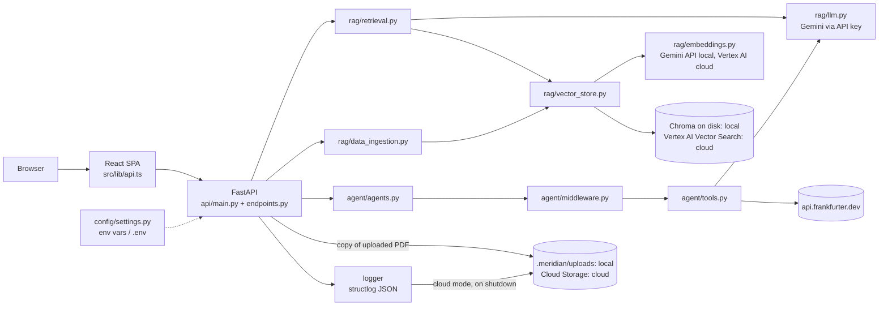

# Meridian AI

A small web app that does two jobs using AI:

1. **Ask questions about your documents.** Upload PDFs, then ask in plain English. The prompt tells the model to answer only from the retrieved passages and to say it does not know otherwise.
2. **Check a purchase before paying.** Paste a purchase request. Three AI "specialists" (risk, tax, financial control) review it, and a final "CFO" step writes one memo with a decision.

It is built to **learn from**. The company in the examples, *Aldermoor Industries*, is **fictional**, and the sample documents contain made-up data.

> The audit "checks" are produced by the AI from its general knowledge. Only the exchange-rate check uses a live data source (api.frankfurter.dev), with an AI estimate as a fallback. This is a demo of how such a system is built, **not** a real compliance tool.

**Verification status.** This README was rewritten from the code. Commands marked **verified** were run on Windows 11 PowerShell. Commands marked **not yet verified** are documented but have not been run, because Python 3.12 is not installed on the machine used. Evidence is in `docs/setup-log.md`.

**What changed with v1.1 (merged from the mentor's repository).** The app now has two modes, chosen by `APP_MODE`: `local` (default; needs only a Gemini key) and `cloud` (Google Cloud). Verified after the merge: `pytest backend/tests` 20 passed, `npm test` 16 passed, `tsc` clean. The reference run of the mentor's code started the server in local mode and answered `/api/health` and `/api/status`, but its document upload failed because the Gemini key had no credit, so **local-mode upload, Q&A and audit are NOT VERIFIED end to end**, and cloud mode is NOT VERIFIED.

**Jump to:** [Features](#features) · [Architecture](#architecture) · [Technology](#technology-stack) · [Prerequisites](#prerequisites) · [Quick start](#quick-start) · [Configuration](#configuration) · [Usage](#usage) · [Structure](#project-structure) · [Testing](#testing) · [Deployment](#deployment-and-cost) · [Troubleshooting](#troubleshooting) · [Contributing](#contributing)

---

## Features

All features below exist in the code.

| Feature | Where | Needs |
|---|---|---|
| Document Q&A with three retrieval strategies: `similarity` (3 chunks), `multiquery`, `contextual` (10 chunks, then trimmed) | `backend/rag/retrieval.py` | Local: Gemini key. Cloud: Google Cloud (Vector Search) + Gemini key |
| PDF upload: chunks of 1000 characters with 100 overlap, embedded and indexed; a copy of the PDF is kept | `backend/rag/data_ingestion.py`, `document_store.py` | Local: Gemini key. Cloud: Google Cloud |
| Bulk index of every PDF already in the document store (local folder or bucket) | `backend/rag/data_ingestion.py` | Same as above |
| Purchase audit: risk, tax and control agents run one after another, then a CFO memo | `backend/agent/agents.py` | Gemini key only |
| Agent middleware: e-mail and card redaction, call limits, retries, one log line per tool call | `backend/agent/middleware.py` | Nothing extra |
| Five audit tools: sanctions screen, vendor credit score, cross-border tax, FX hedge check, CapEx/OpEx classification | `backend/agent/tools.py` | Gemini key (FX also calls api.frankfurter.dev; the result says "LLM-estimated" when the live call failed) |
| Health and status endpoints (both report the mode) | `backend/api/endpoints.py` | Nothing |
| React components for Q&A, document upload, audit and system status (how they are arranged into tabs in `pages/Index.tsx` was not read) | `frontend/src/components/` | Backend running |
| JSON logging; in cloud mode the log file is uploaded to Cloud Storage on shutdown when a bucket is set | `backend/logger/custom_logger.py` | Optional |

**Not in the code:** user accounts or authentication, a database, background jobs, queues, or per-user document separation.

## Local mode and cloud mode (`APP_MODE`)

| | `APP_MODE=local` (default) | `APP_MODE=cloud` |
|---|---|---|
| Needs | A Gemini API key only | Google Cloud project, bucket, Vector Search index and endpoint, plus the key |
| Vector database | Chroma, saved in `.meridian/chroma` | Vertex AI Vector Search |
| Embedding model | `gemini-embedding-001` through the Gemini API (a billed call, not a local model) | `text-embedding-005` through Vertex AI |
| Uploaded PDFs | `.meridian/uploads/` | Cloud Storage bucket |
| Logs | `logs/` | `logs/`, copied to the bucket on shutdown |

Both modes use the Gemini API key for the chat model. Indexes are not interchangeable between modes (different embedding models). If cloud mode starts with empty cloud settings, the API answers HTTP 503 and names the missing variables. `GET /api/status` shows the active mode. More detail: [docs/20-local-cloud-and-middleware.md](docs/20-local-cloud-and-middleware.md). A beginner-oriented tour of the code is in `docs/01-the-case.md` to `docs/19-glossary.md` (taken from the mentor's repository; see the note on `docs/REFERENCE.md` under Contributing).

## Architecture



Package dependencies point one way: `api` uses `rag` and `agent`; `agent` uses `rag.llm`; `rag` and `agent` use `config` and `logger`; `logger` uses `config`.

**Ask a question:** the page sends `POST /api/rag/ask`. The backend embeds the question, the vector store (Chroma or Vector Search, by mode) returns the closest chunks, and Gemini answers from them.

**Run an audit:** `POST /api/agent/audit` runs the risk, tax and control agents in order. Each decides which tools to call. Then one plain Gemini call writes the memo. An audit makes roughly 11 or more Gemini calls (inferred from the code, not measured).

In Docker, one server serves both the API and the built web page on port 8080 (`backend/api/main.py`, `Dockerfile`).

## Technology stack

| Technology | Role | Version |
|---|---|---|
| Python | Backend language | 3.12 (`requirements.txt` says "Tested with Python 3.12") |
| FastAPI / uvicorn | Web API | 0.135.1 / 0.41.0 |
| Pydantic / pydantic-settings | Request validation and settings | 2.12.5 / 2.15.0 |
| LangChain (`langchain`, `-core`, `-community`, `-text-splitters`) | Agents and middleware, retrieval chain, PDF loading | 1.2.11 / 1.2.18 / 0.4.1 / 1.1.1 |
| langchain-google-genai | Gemini chat model, and embeddings in both modes | 4.2.1 |
| langchain-chroma / chromadb | Local-mode vector store | 1.1.0 / 1.5.9 |
| langchain-google-vertexai | Cloud-mode Vector Search store | 3.2.2 |
| langgraph | Engine behind `create_agent` (no graph code written here) | 1.1.6 |
| google-cloud-aiplatform / google-cloud-storage | Google Cloud clients | 1.141.0 / 3.9.0 |
| pypdf | PDF reading | 6.7.5 |
| structlog | JSON logging | 26.1.0 |
| React / Vite / TypeScript | Frontend | React ^18.3.1, Vite 5.4.21 (built), TypeScript ^5.8.3 |
| Tailwind CSS, shadcn/ui (Radix) | Styling and components | Tailwind ^3.4.17 |
| Vitest, ESLint, Playwright | Frontend test and lint tools | vitest 3.2.4 |
| Docker, Cloud Run, Secret Manager, GitHub Actions | Packaging and deployment | see [Deployment](#deployment-and-cost) |

Backend versions are pinned in `requirements.txt`. All pinned versions installed together on Python 3.12.10 after the merge (`pip install -r requirements.txt -r requirements-dev.txt` succeeded and `pip check` found no conflicts; verified). All packages are installed in both modes; the cloud store is imported only in cloud mode. Frontend dependencies use `^` ranges with `package-lock.json`.

## Prerequisites

| For | You need | Status on the machine used |
|---|---|---|
| Backend | **Python 3.12** (not enforced by the repo) | 3.12.10 installed with winget; a Microsoft Store Python 3.13.14 is also present and was not used |
| Frontend | **Node 20+** (the Dockerfile builds with Node 20) | Verified on Node v25.5.0, npm 11.10.0 |
| Everything | Git | 2.52.0 |
| Audit feature | A Gemini API key (link taken from the original README, not checked: https://aistudio.google.com/apikey) | Not used yet |
| Document Q&A, local mode | The same Gemini API key (embeddings are also a Gemini API call) | Upload hit "credits depleted" in the reference run |
| Document Q&A, cloud mode | A Google Cloud project with a Vector Search index and endpoint ([DEPLOY.md](DEPLOY.md)) | Not used |
| Docker run | Docker | 29.2.0 present; build not run |

## Quick start

Run backend commands from the repository root. Settings read `.env` from the current directory.

### Frontend (verified on Windows PowerShell)

```powershell
cd frontend
npm ci          # installs 498 packages from package-lock.json
npm test        # vitest: 1 test passes
npm run build   # writes frontend/dist
```

`npm run lint` currently **fails** (9 errors, 7 warnings in existing code). `npm ci` reports 33 audit findings; nothing has been upgraded.

### Backend (install and tests verified; starting the server not yet verified)

```powershell
python -m venv .venv
.venv\Scripts\Activate.ps1
pip install -r requirements-dev.txt
copy .env.example .env          # then edit .env and set GOOGLE_API_KEY (leave APP_MODE=local)
uvicorn api.main:app --app-dir backend --reload --port 8080
```

With `APP_MODE=local` no Google Cloud account is needed. Data is written under `.meridian/` (git-ignored).

What was actually run (Git Bash on Windows, calling the venv's Python directly instead of activating it): `<path-to-python3.12> -m venv .venv`, then `./.venv/Scripts/python.exe -m pip install -r requirements-dev.txt` (exit 0). `Activate.ps1`, `copy` and `uvicorn` were not run. If `python` is not on your PATH, use the full path to Python 3.12 or the venv's `python.exe`.

Then open **http://localhost:8080/docs** (the API docs FastAPI generates). `GET /api/health` should return `{"status": "ok"}` even with no `.env`, because clients connect lazily on first use (INFERRED from the code at `backend/rag/llm.py:12` and `backend/api/endpoints.py:41`; not run).

### Run the web page in development (not yet verified)

```powershell
cd frontend
npm run dev     # serves on http://localhost:3000
```

In development the page calls `http://localhost:8080` unless `VITE_API_URL` is set (`frontend/src/lib/api.ts:5`).

### Docker (not yet verified)

```powershell
docker build -t meridian-ai .
docker run -p 8080:8080 --env-file .env meridian-ai
```

For local mode, add `-v meridian-data:/app/.meridian` so the vector database and uploads survive removing the container (`/app/.meridian` is owned by the non-root `app` user in the image). The Docker build with the merged code has not been re-run.

`--env-file .env` puts your secrets into the container. The image does not contain `.env` (`.dockerignore`).

## Configuration

Settings are read from environment variables, then from `.env` in the current directory (`backend/config/settings.py`). Never commit `.env` (it is git-ignored). Use placeholders like these, never real values.

| Variable | Required? | Purpose | Example placeholder |
|---|---|---|---|
| `APP_MODE` | Optional (default `local`) | `local` or `cloud`; see the section above | `local` |
| `GOOGLE_API_KEY` | Required in both modes | Gemini API key (chat, and embeddings in local mode) | `<your-gemini-api-key>` |
| `LOCAL_DATA_DIR` | Optional, local mode | Folder for Chroma and uploads (default `.meridian` in the repo root) | `<path>` |
| `CHROMA_COLLECTION` | Optional, local mode | Chroma collection name | `meridian_docs` |
| `LOCAL_EMBEDDING_MODEL_NAME` | Optional, local mode | Gemini API embedding model | `gemini-embedding-001` |
| `AGENT_MAX_MODEL_CALLS`, `AGENT_MAX_TOOL_CALLS`, `AGENT_MAX_RETRIES` | Optional | Agent middleware limits (defaults 8, 6, 2) | `8` |
| `GCP_PROJECT_ID` | Cloud mode only | Google Cloud project | `<your-gcp-project-id>` |
| `GCP_REGION` | Cloud mode only | Region of Vertex AI resources (code default `us-central1`) | `us-central1` |
| `GCS_BUCKET_NAME` | Cloud mode only | Bucket for uploads, index staging and logs | `<your-bucket-name>` |
| `GCS_PREFIX` | Optional, cloud mode | Folder for uploads; keep the trailing `/` (default `uploads/`) | `uploads/` |
| `VECTOR_SEARCH_INDEX_ID` | Cloud mode only | Vector Search index ID | `<your-index-id>` |
| `VECTOR_SEARCH_INDEX_ENDPOINT_ID` | Cloud mode only | Vector Search endpoint ID | `<your-endpoint-id>` |
| `GCP_SERVICE_ACCOUNT_PATH` | Optional, cloud mode | Path to a key file; sets `GOOGLE_APPLICATION_CREDENTIALS` if the file exists | `<path-to-key.json>` |
| `VERTEX_LLM_MODEL_NAME` | Optional | Gemini model. Default `gemini-3.8-flash` is **not verified to exist** | `<current-gemini-model>` |
| `VERTEX_EMBEDDING_MODEL_NAME` | Optional, cloud mode | Vertex embedding model; must output 768 dimensions. Default `text-embedding-005` | `text-embedding-005` |
| `LLM_TEMPERATURE` | Optional | `0` gives the most repeatable answers (default `0`) | `0` |
| `ENVIRONMENT` | Optional | Read into settings but not used by any code | `local` |
| `PORT` | Docker only | Port the container listens on (default 8080) | `8080` |
| `VITE_API_URL` | Optional, frontend build | Backend URL the page calls (set it if the backend is not on port 8080) | `http://localhost:8080` |

There are no settings for log level or log folder; they are fixed in code (INFO, `./logs`).

## Usage

All examples are **not yet run**. Audit and Q&A calls use Google services and can cost money or hit rate limits.

**Health and status (free, local):**
```powershell
Invoke-RestMethod http://localhost:8080/api/health
Invoke-RestMethod http://localhost:8080/api/status
```

**Audit (needs `GOOGLE_API_KEY`; sends the text to Google; allow a minute or more):**
```powershell
$body = '{"request_text": "Purchase of 200 PLC controllers from Takumi Controls Europe B.V. (Netherlands). Total 480,000 EUR. Origin JP, destination DE. FX rate quoted: 1 EUR = 163.5 JPY."}'
Invoke-RestMethod -Method Post -Uri http://localhost:8080/api/agent/audit -ContentType "application/json" -Body $body
```
The reply has `risk_result`, `tax_result`, `control_result` and `cfo_memo`. Wording varies between runs.

**Index documents (local mode: Gemini key; cloud mode: Google Cloud):**
```powershell
curl.exe -F "files=@sample_docs/aldermoor_procurement_policy.pdf" http://localhost:8080/api/rag/upload
Invoke-RestMethod -Method Post -Uri http://localhost:8080/api/rag/ingest
```
`/api/rag/ingest` indexes every PDF in the document store (`.meridian/uploads/` or the bucket); the old `/api/rag/ingest-gcs` name still works. (`curl.exe` being present on your machine is NOT VERIFIED; the upload field name is `files`.)

**Ask a question (needs documents indexed):**
```powershell
Invoke-RestMethod -Method Post -Uri http://localhost:8080/api/rag/ask -ContentType "application/json" -Body '{"query": "What are the standard payment terms for servo motor suppliers?", "retriever_type": "similarity"}'
```
`retriever_type` is `similarity` (default), `multiquery` or `contextual`; any other value falls back to `similarity`.

**Other routes:** `GET /api/rag/uploads` lists uploads from the current session (kept in memory, lost on restart).

**Script:** from the `backend` folder, `python -m agent.agents` runs a built-in sample audit and prints the memo.

## Project structure

```
backend/
├── api/            main.py (app wiring, CORS, serves the built frontend), endpoints.py (routes), schemas.py
├── rag/            llm.py, embeddings.py, vector_store.py, document_store.py, data_ingestion.py, retrieval.py
├── agent/          agents.py (supervisor), tools.py (5 tools), prompts.py, middleware.py
├── config/         settings.py (environment settings, APP_MODE)
├── exceptions/     ConfigurationError (HTTP 503), IngestionError (HTTP 422)
├── logger/         custom_logger.py (JSON logs; upload to GCS on exit in cloud mode)
└── tests/          conftest.py (fake env), test_api.py, test_modes_and_middleware.py
frontend/           React + TypeScript + Vite; src/lib/api.ts is the only backend client
sample_docs/        Four fictional PDFs
docs/               Discovery notes, setup-log.md, and the mentor's learner guide (01 to 20)
.github/workflows/  deploy.yml
Dockerfile, requirements.txt, requirements-dev.txt, .env.example, DEPLOY.md
```

## Testing

Backend (verified after the v1.1 merge: 20 passed, about 10 seconds; run from the repo root with the venv's Python):
```powershell
.\.venv\Scripts\python.exe -m pytest backend/tests -q
```
(Verified from Git Bash as `./.venv/Scripts/python.exe -m pytest backend/tests -q`.)
`test_api.py` has 9 tests (health, status, 404, ask, audit, non-PDF upload, chunking, sample PDFs, log severity); `test_modes_and_middleware.py` adds the local/cloud and middleware tests, an upload-then-ingest duplicate check and offline health/status/503 checks. They fake all external calls and need no accounts or network. They do not exercise real Gemini, Vertex Vector Search or Cloud Storage.

Frontend (verified): `cd frontend; npm test` passes 16 tests (1 placeholder plus 15 characterization tests for `RagQATab` and `AuditTab`, with the API client mocked). `npx tsc --noEmit -p tsconfig.app.json` passes. `npm run lint` currently fails (16 existing problems).

## Deployment and cost

`.github/workflows/deploy.yml` runs **only when you start it by hand** (Actions → Deploy to GCP Cloud Run → Run workflow). It no longer starts on a push to `main`. If its GitHub secrets are set, a run:
- creates a Vector Search index and endpoint, **billed by the hour even when idle**;
- stores your Gemini key in Secret Manager;
- deploys a **public Cloud Run service with no login** (anyone with the URL can use your Gemini quota and upload files).

Read [DEPLOY.md](DEPLOY.md) first: it explains costs, budget alerts and how to switch everything off. The workflow has no test step.

## Troubleshooting

| What you see | What to do |
|---|---|
| `python` or `py` not found | Python may be installed but not on your PATH. Use its full path or the venv's `.venv\Scripts\python.exe` |
| `ModuleNotFoundError: No module named 'api'` | Run from the repo root and keep `--app-dir backend` |
| Settings seem empty | Run from the repo root; `.env` is looked up in the current directory |
| AI features fail with auth or "model not found" errors | Check `GOOGLE_API_KEY`; set `VERTEX_LLM_MODEL_NAME` to a current model (default not verified) |
| Q&A returns 503 naming variables | Cloud mode with empty cloud settings: set the named variables, or use `APP_MODE=local` |
| Upload or Q&A returns 500 with `RESOURCE_EXHAUSTED` / 402 | The Gemini key's project has no credit; embeddings in local mode use the same key |
| Q&A returns 500 (cloud mode) | Index ID, endpoint ID, project, region or bucket are unset or wrong; a 403 usually means the wrong account or key (see `DEPLOY.md`; not reproduced here) |
| Audit returns text saying "Manual review required" | A tool's AI call failed and the tool degraded instead of raising; check the logs |
| Port already in use | Stop the other program, or use `--port 8081` and set `VITE_API_URL` |
| Page shows "Failed to fetch" | The backend is not running, or `VITE_API_URL` points to the wrong address |
| PowerShell shows `NativeCommandError` for npm warnings | Check `$LASTEXITCODE`; the warnings are not failures |
| `npm run lint` fails | Known: existing code has 16 lint problems |

The backend logs one JSON line per event to the console and to `logs/<timestamp>.log`. Since the v1.1 merge the logs record lengths and ids (query, answer and audit text lengths; tool names and argument names), not the text itself. Still treat them as sensitive: uploaded file names and some error messages are logged.

## Contributing

- Work on a branch and open a pull request. Deployment is manual, so a merge to `main` does not deploy.
- Keep changes small, one logical change per commit, and run the tests before and after.
- Never commit `.env`, keys or credentials; use placeholders in docs and examples.
- Follow the existing style: thin routes, `from logger import GLOBAL_LOGGER as log`, settings via `config.settings`, and tests with fakes (see `CLAUDE.md`).
- Do not upgrade dependencies without discussing it first.
- Record notable decisions and command results in `docs/setup-log.md`.
- `docs/REFERENCE.md`, `docs/ARCHITECTURE.md` and `docs/UNDERSTANDING.md` were written before the local/cloud change and are not updated yet; the code is the source of truth.

---

*Aldermoor Industries and all sample data are fictional.*
